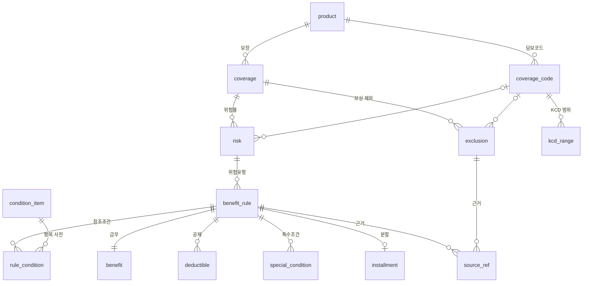

# 사고보장 데이터 테이블 설계 (`src/coverage_store/`)

[사고보장 Canonical Schema](coverage_schema.md)(`schema.coverage.Product`)로 만든 데이터를 **관계형 테이블**에 저장하는 설계입니다.
JSON 하나로 다루던 사고보장 데이터를 시스템 기준정보처럼 행 단위로 저장·조회하고, 다시 JSON 으로 되돌릴 수 있습니다.

- 테이블 정의: [`src/coverage_store/schema.sql`](../src/coverage_store/schema.sql) (SQLite)
- 변환 코드: [`src/coverage_store/store.py`](../src/coverage_store/store.py) — `save_product`, `load_product`
- 테스트: `tests/test_coverage_store.py` (저장 → 읽기 하면 원래 Product 와 같아야 함)

> 테이블은 업무 시스템의 사고보장 구조(보장 → 위험률 → 위험유형 → 참조조건·특수조건·급부·분할, 담보코드 → KCD)를
> **개념만** 따랐습니다. 테이블·컬럼 이름은 일반 이름이며 내부 시스템 이름과 무관합니다.

## 1. 사용법

```bash
# 저장: 사고보장 JSON → DB (coverage_extract --out 결과 형식도 됨)
uv run python -m coverage_store save tests/fixtures/silson_2605_disease_covered.json \
    --db coverage.db --id silson-2605

# 상품 목록과 테이블별 행 수
uv run python -m coverage_store show --db coverage.db
#  [silson-2605] 삼성 급여 실손의료비보장보험(2605)(갱신형, 무배당) 약관
#    product 1 · coverage 1 · coverage_code 5 · kcd_range 7 · risk 3 · exclusion 7 · benefit_rule 4 ·
#    rule_condition 11 · benefit 4 · deductible 6 · special_condition 1 · installment 0 · source_ref 21

# 되돌리기: DB → 사고보장 JSON
uv run python -m coverage_store load --db coverage.db --id silson-2605 --out out.json
```

```python
from coverage_store import connect, save_product, load_product

conn = connect("coverage.db")             # 테이블·참조조건 항목 사전을 만듦 (있으면 그대로)
save_product(conn, product, "silson-2605")  # 같은 id 가 있으면 지우고 다시 저장 (한 트랜잭션)
same = load_product(conn, "silson-2605")    # same == product
```

## 2. 구조



| 테이블 | 업무 개념 | 키 | 스키마 대응 |
|---|---|---|---|
| `product` | 상품 | `product_id` | `Product` |
| `coverage` | 보장 (주계약·특약) | `product_id, coverage_id` | `Coverage` |
| `risk` | 위험률 = 보장종목 × 청구사유 (× 담보코드) | `product_id, risk_id` | `Risk` |
| `benefit_rule` | 위험유형 = 지급 규칙 | `product_id, rule_id` | `BenefitRule` (+ `conditions.facility`, `occurrence`) |
| `rule_condition` | 참조조건 (항목코드 · 값) | `product_id, rule_id, seq` | `RuleConditions` 의 기간·한도 |
| `condition_item` | 참조조건 항목 사전 | `item_code` | (코드 → 이름·단위) |
| `benefit` | 급부 (유형·기준·비율·자기부담 상한) | `product_id, rule_id` | `Benefit` |
| `deductible` | 공제금액 기준 (정액·비율·본인부담률) | `product_id, rule_id, seq` | `Benefit.deductible` |
| `special_condition` | 특수조건 (규칙 간 관계 포함) | `product_id, rule_id, seq` | `SpecialCondition` |
| `installment` | 분할지급 | `product_id, rule_id` | `Installment` |
| `exclusion` | 보상하지 않는 사항 | `product_id, exclusion_id` | `Exclusion` |
| `coverage_code` | 담보코드 = KCD 묶음 | `product_id, code` | `CoverageCode` |
| `kcd_range` | 담보코드의 KCD 범위 (차수·효력기간) | `product_id, code, seq` | `KcdRange` |
| `source_ref` | 약관 근거 (조·항·호·별표·인용문) | `product_id, target_type, target_id, seq` | `SourceRef` (`source`, `extra_sources`) |

목록 순서는 모든 테이블의 `seq` 로 지킵니다 (규칙 순서, 공제 기준 순서, 금액 한도 순서 등).

## 3. 설계 결정

**모든 키에 `product_id`**
규칙 id 는 같은 약관을 다시 추출해도 같게 나오도록 `p0/질병급여형/outpatient2/1` 처럼 만듭니다([coverage_extract.md](coverage_extract.md)).
그래서 실손 2601 과 2605 의 규칙 id 가 같습니다. 모든 키를 `(product_id, …)` 로 두어 개정 전후 상품을 한 DB 에 넣고,
같은 `rule_id` 끼리 비교할 수 있게 했습니다 (개정 비교).

**참조조건은 항목코드 · 값 한 줄씩 (`rule_condition`)**
면책기간·감액기간·한도·연장 보상처럼 상품마다 있는 것과 없는 것이 다른 값은 컬럼으로 늘리지 않고 행으로 저장합니다.
새 조건이 생기면 `condition_item` 에 코드만 추가하면 됩니다. 값의 이름·단위는 항목 사전에 있습니다.

| 항목코드 | 이름 | 단위 | 스키마 |
|---|---|---|---|
| `EXEMPT_DAYS` | 면책기간 | 일 | `conditions.exemption_days` |
| `REDUCE_DAYS` / `REDUCE_RATIO_NUM` / `REDUCE_RATIO_DEN` | 감액기간 / 감액 지급비율 분자·분모 | 일 / - | `conditions.reduction` |
| `DEDUCT_DAYS` | 공제일수 | 일 | `conditions.deductible_days` |
| `LIMIT_EVENT_DAYS` / `LIMIT_TOTAL_DAYS` / `LIMIT_COUNT` | 1회 입원당 한도일수 / 통산 한도일수 / 지급 횟수 | 일 / 일 / 회 | `conditions.limit` |
| `LIMIT_AMT_<단위>` | 금액 한도 (`VISIT` 통원 1회당, `DAY`, `STAY`, `YEAR`, `DAILY_AVERAGE`, `EVENT`) | 원 | `conditions.limit.amounts` (`selectable` 컬럼 = 계약자 선택) |
| `EXT_DAYS` / `EXT_VISITS` | 계약 종료 후 보상 일수 / 통원 최대 횟수 | 일 / 회 | `conditions.extension` |

규칙 하나에 하나만 있는 값(급부 유형·보상률·자기부담 상한·공제 선택 방식)은 `benefit` 컬럼으로 둡니다.

**근거는 한 테이블 (`source_ref`)**
규칙·보상 제외·보장·담보코드의 근거를 `target_type` + `target_id` 로 한곳에 모았습니다.
`role` 은 `primary`(대표 근거, 스키마의 `source`) 와 `extra`(한도 등 다른 조의 근거, `extra_sources`).
근거 검증·화면에서 "이 규칙은 어느 조·항에 근거하나"를 테이블 하나로 찾을 수 있습니다.

**DB 에서 지키는 것**
- 외래키(`PRAGMA foreign_keys = ON`): 규칙 → 위험률 → 보장 → 상품, 담보코드 참조, 항목 사전에 없는 참조조건 코드 거부.
- `CHECK`: 보장 종류(main·rider), 상태(confirmed·needs_review), 급부 유형, 공제 기준 종류 등.
- 상품을 지우면 딸린 행이 함께 지워짐(`ON DELETE CASCADE`). `save_product` 는 같은 id 를 지우고 다시 넣습니다.

## 4. 예시: 실손 2605 《질병급여형》 급여 통원(의원)

정답 파일 `tests/fixtures/silson_2605_disease_covered.json` 의 규칙 `p0/질병급여형/outpatient2/1` 은 이렇게 저장됩니다.

`benefit_rule`

| rule_id | risk_id | seq | name | insured_role | facility | status |
|---|---|---|---|---|---|---|
| p0/질병급여형/outpatient2/1 | p0/질병급여형/outpatient2 | 1 | 급여 통원 - 의원·보건소·약국 등 | primary | 의원·보건소·보건진료소의 외래, 약국… | needs_review |

`rule_condition`

| seq | item_code | value | selectable |
|---|---|---|---|
| 1 | LIMIT_AMT_VISIT | 200,000 | 1 |
| 2 | LIMIT_AMT_YEAR | 50,000,000 | 1 |
| 3 | EXT_DAYS | 180 | 0 |
| 4 | EXT_VISITS | 90 | 0 |

`benefit` · `deductible`

| benefit_type | base | cost_type | deductible_pick | | deductible: kind | amount | ratio |
|---|---|---|---|---|---|---|---|
| actual_cost | medical_cost | covered | max | | AMOUNT | 10,000 | |
| | | | | | RATIO | | 20/100 |
| | | | | | COPAY_RATE | | |

`source_ref`

| target_type | seq | role | part | section | article | paragraph | quote |
|---|---|---|---|---|---|---|---|
| rule | 1 | primary | 삼성 급여 실손의료비보장보험(2605)… | 질병급여형 | 제3조 | 1 | ＜표 1>의 ‘통원항목별 공제금액’을 뺀 금액 |
| rule | 2 | extra | 삼성 급여 실손의료비보장보험(2605)… | | 제5조 | 5 | 통원 1회당 20만원 이내에서 … |

(근거 검증을 거치면 status 는 `confirmed` 로 저장됩니다. 정답 파일 자체는 `needs_review` 로 들어 있습니다.)

## 5. 한계와 다음 할 일

- `conditions.limit` 가 값 없이 비어 있으면(`Limit()`) 저장할 행이 없어 읽을 때 `None` 이 됩니다. 의미는 같습니다.
- 특수조건의 `related_rule_id` 는 규칙이나 보상 제외를 가리킬 수 있어 외래키를 걸지 않았습니다 (스키마 검사가 확인).
- 근거 검증 결과(`GroundingIssue`)와 정답 비교 결과는 아직 테이블이 없습니다. 검토 화면을 만들 때 추가 예정.
- 개정 비교: 두 상품을 저장한 뒤 `rule_id` 로 조인해 `rule_condition`·`benefit` 값을 비교하는 쿼리/명령이 다음 단계입니다.
